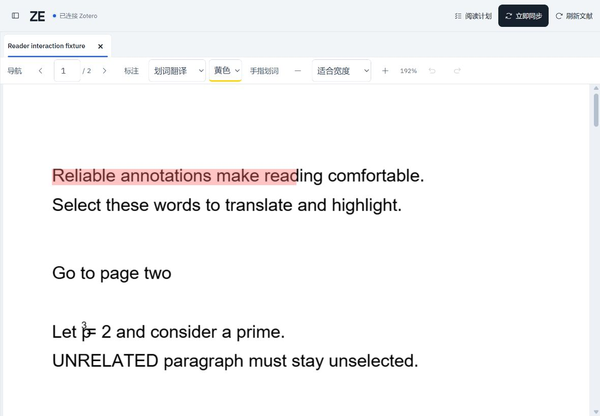
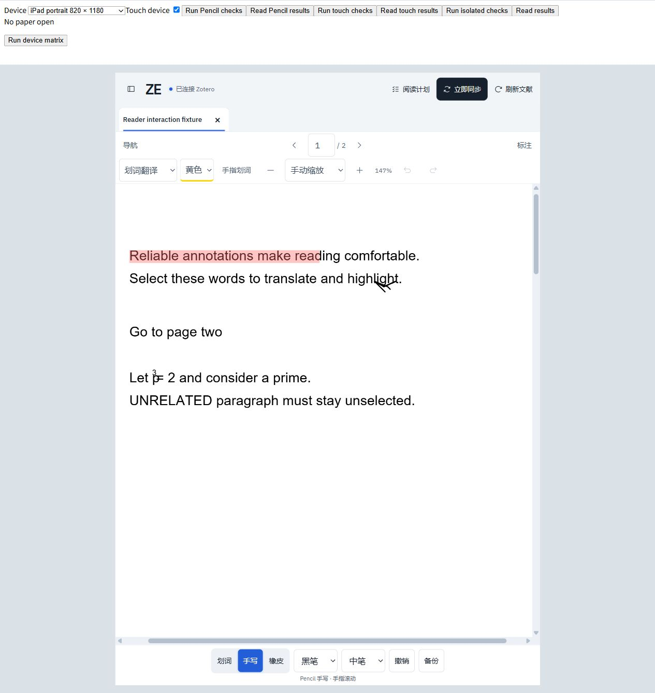
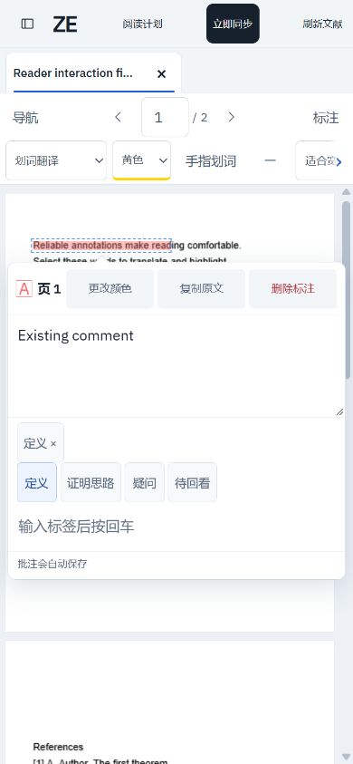

# ZE

## ZE Reader 统一插件

[ZE Reader 安装与使用](plugins/ze-reader/README.md) 将阅读路线列和 Translate Bridge 合并为一个 XPI，并新增标签页分组、笔记与标注汇总、文献矩阵。面向 Zotero 10.0.x；运行 `npm.cmd run build:plugin` 生成 `plugins/ze-reader/ze-reader.xpi`。旧独立插件仍保留兼容入口，建议新安装使用统一版。

在浏览器里阅读自己的 Zotero 论文，支持电脑、iPad 和手机。

> **Zotero 必须一直保持开启，ZE 也需要在主机上运行。** Zotero 关闭后，只能使用浏览器已有缓存、当前已打开的论文和未同步草稿；无法新开论文、刷新文库、同步标注或使用 CNKI。重新打开网页后，不保证还能读取 PDF；ZE 不会把论文文件长期缓存在浏览器里。



## 可以做什么

- 按 Zotero 分类浏览文库，多篇论文用标签页切换。
- 划词自动翻译，支持 CNKI、Google 和微软。
- 高亮、下划线、批注、标签和批注管理。
- 阅读计划、续读、目录、文内搜索与参考文献导航。
- iPad 使用 Apple Pencil 划词或手写，底部切换划词、手写和橡皮。
- 标注先缓存，空闲后同步；也可以点击“立即同步”。同步失败会保留草稿。

## 安装前准备

主机目前支持 **64 位 Windows 10 / 11**。先安装 [Zotero 10 或更新版本](https://www.zotero.org/download/)，并将要读的 PDF 附件下载到这台电脑。

| 依赖 | 是否需要自己安装 |
| --- | --- |
| Zotero 10+ | **需要**，阅读期间一直开着 |
| uv、Python 3.12、Node.js 22+ | 一行安装自动准备；已安装且符合要求时会复用 |
| zotero-mcp-server / zotero-cli、PyMuPDF、cryptography 等 Python 依赖 | 一行安装自动安装到 ZE 自己的环境 |
| ZE 前端所需依赖 | 一行安装自动下载和构建 |
| Translate for Zotero + ZE Translate Bridge | **仅 CNKI 需要**，按下方步骤安装 |
| Cloudflare Tunnel 和自己的域名 | 仅互联网访问需要，自行配置 |

不需要安装 Git，也不需要另外启动 MCP 服务或安装 AI 客户端。

## 一行 PowerShell 安装

打开普通 PowerShell，粘贴：

```powershell
irm https://raw.githubusercontent.com/Xioaruan912/ZE/main/install.ps1 | iex
```

安装期间需要联网访问 GitHub、Python 和 Node.js 的下载站点。默认安装到 `%LOCALAPPDATA%\ZE`，无需管理员权限。首次安装会让你设置自己的访问口令，**没有默认口令**，并创建桌面的 ZE 快捷方式。

此命令会下载并执行本仓库的安装脚本。想先查看内容，可打开 [install.ps1](install.ps1)。

## 第一次使用

1. 打开 Zotero，在 **设置 → 高级** 勾选“允许此计算机上的其他应用程序与 Zotero 通信”。
2. 打开 ZE 安装目录，双击 **`configure-zotero.bat`**，在 Zotero 弹出的写入授权窗口里选择“始终允许”。这一步用于把网页标注写回 Zotero。
3. 双击桌面的 **ZE**，或安装目录里的 **`start-reader.bat`**。
4. 在浏览器打开 **http://127.0.0.1:8765**，输入安装时设置的口令。
5. 从左侧选择论文即可阅读。首次输入口令后，该浏览器会保持信任；清除浏览器数据或修改口令后需要重新登录。

使用期间保持 ZE 的运行窗口和 Zotero 开启。关闭窗口会停止 ZE；电脑关机、休眠或断网时，其他设备也无法连接。

## 使用 CNKI 翻译

Google 和微软翻译可直接在划词浮层中选择，是否可用取决于主机的网络。

CNKI 还需要以下设置：

1. 在 Zotero 安装 [Translate for Zotero](https://github.com/windingwind/zotero-pdf-translate/releases)，选择适合 Zotero 版本的插件。
2. 在该插件里配置 CNKI，先确认桌面 Zotero 可以正常翻译。
3. ZE 安装时会在本机生成 **`paper-reader-bridge.xpi`**。在 Zotero 的 **工具 → 插件 → 齿轮 → 从文件安装插件** 中选择它。
4. 重启 Zotero，回到 ZE，将翻译服务切换为 CNKI。

桥接安装包是针对你这台主机生成的，**不要分享自己的 XPI 或 `bridge.token`**。重装插件时，使用同一 ZE 目录中新生成的安装包。CNKI 仍需联网，可能受验证或服务限制影响。

## iPad 和手机



在 iPad 或手机上访问主机对应的网址即可。iPad 底部的“划词 / 手写 / 橡皮”用于明确选择 Pencil 的用途：划词模式自动翻译，手写模式不触发翻译，手指用于滚动。可换笔色、粗细，撤销上一笔或导出备份。

已有高亮、下划线和笔迹可在划词模式下点开批注卡片，编辑内容、换色或删除。批注先保存在浏览器，再交给主机同步；发现同步冲突或 PDF 变化时，请在批注管理中核对。

浏览器存储不足时页面会提示备份，此时先导出草稿再关闭网页。清除站点数据会删除尚未交给主机的浏览器草稿。

<details>
<summary>查看手机批注界面</summary>



</details>

## 通过互联网访问

在主机上安装并配置 [Cloudflare Tunnel](https://developers.cloudflare.com/cloudflare-one/connections/connect-networks/)，把自己的域名指向 **`http://127.0.0.1:8765`**。然后在 iPad、手机或其他电脑打开该 HTTPS 域名，用同一个 ZE 口令登录。

ZE 默认只监听本机地址，不需要将 Zotero 接口或主机端口直接公开。请设置独立口令；有需要时再加 Cloudflare Access。Tunnel 不会代替 ZE 或 Zotero 运行，两者都必须保持开启。

## 常见问题

**打不开论文或按钮变灰？** 先确认主机上的 Zotero 正在运行、本地通信已启用，PDF 附件已下载到主机。只有文献信息而没有本地 PDF 时无法阅读。

**同步失败会丢批注吗？** 正常情况下草稿会留在浏览器或主机的待同步队列，恢复连接和授权后可以重试。不要清理浏览器站点数据或安装目录里的 `reader-data.sqlite`；重要笔迹和批注可以先导出备份。

**怎么修改口令？** 在安装目录运行：

```powershell
.\.venv\Scripts\python.exe change-password.py
```

修改后所有已信任设备需要重新登录。

**怎么更新？** 先关闭 ZE 运行窗口，重新执行一行安装命令，再启动 ZE。安装器会保留口令、桥接令牌、阅读记录和待同步数据；更新前仍建议备份 `reader-data.sqlite`。如果提示已有其他文件，请换一个空目录，不要把已有文库目录当成安装目录。

**文库在其他位置，或端口被占用？** 将 `.env.example` 复制为 `.env`，按其中示例填写 Zotero 数据库路径或修改 `PAPER_READER_PORT`，然后重启 ZE。修改端口后，浏览器地址和 Tunnel 的目标端口也要对应调整。

## 手动安装

已有 **Python 3.12、Node.js 22+** 的用户，也可以下载本仓库 ZIP 并解压，在该目录运行：

```powershell
python -m venv .venv
.\.venv\Scripts\python.exe -m pip install -r requirements.txt
npm.cmd ci
npm.cmd run build
.\.venv\Scripts\python.exe change-password.py
.\.venv\Scripts\python.exe zotero-bridge\build.py
```

之后按“第一次使用”连接 Zotero，再双击 `start-reader.bat`。本机已安装的其他 Zotero 插件不会自动适配到网页；目前支持上述阅读功能与翻译桥接。

## Zotero 桌面阅读路线插件

`plugin` 分支提供独立的[阅读完成与路线插件](plugins/reading-columns/README.md)，在 Zotero 桌面文献列表中勾选“已读”，状态通过 Zotero 标签保存和同步；原有阅读顺序与分支定位列默认隐藏，可从表头菜单重新显示。源码、构建脚本和可安装的 XPI 位于 `plugins/reading-columns/`，与网页阅读器分别安装。

## 开源许可

[AGPL-3.0](LICENSE)。第三方组件见 [THIRD_PARTY_NOTICES.md](THIRD_PARTY_NOTICES.md)。本项目为独立项目，与 Zotero、CNKI、Google、Microsoft 无隶属关系。截图使用项目自带的示例文献，不包含个人文库。
